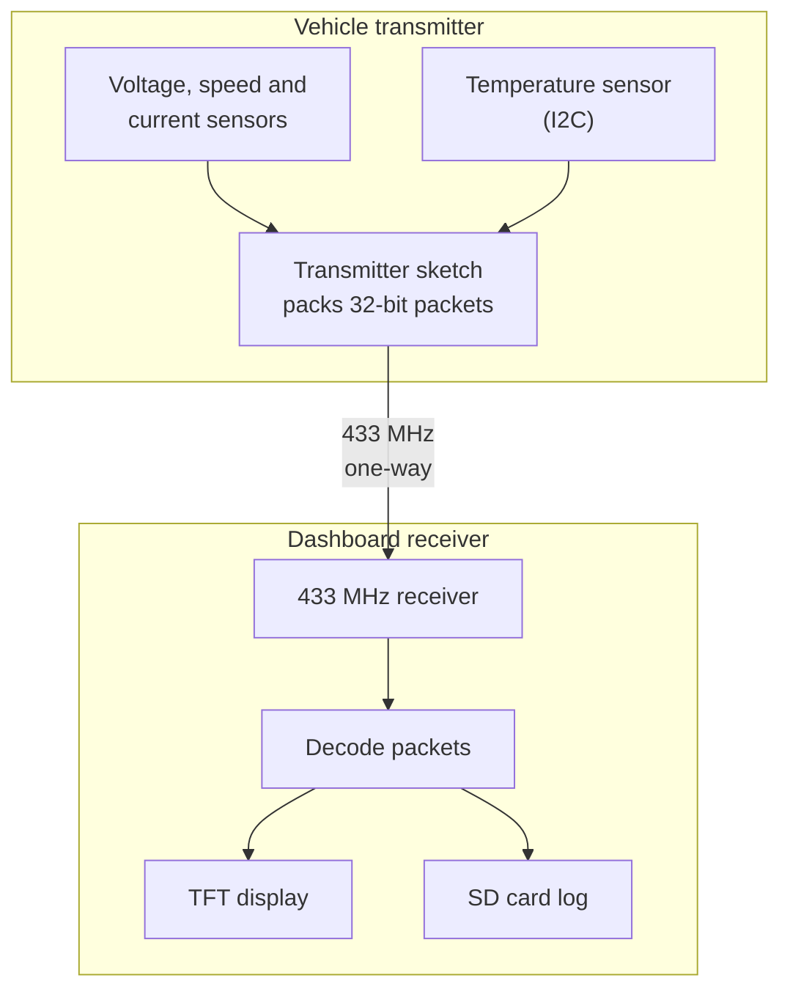

# Electric car telemetry

Arduino sketches for a wireless telemetry link on an electric vehicle prototype. A **transmitter** on the vehicle samples battery voltage, motor speed, four motor currents and battery temperature, packs the readings into 32-bit numbers and sends them over a 433 MHz radio link. A **receiver/dashboard** unit decodes them, shows them on a TFT screen, and logs them to an SD card.

This is a collection of historical hardware prototypes and experiments, including several legacy variants. It is not a validated vehicle monitoring or safety system, and the vehicle's actual electrical design is not part of this repository.

## Project documentation and demo

*Historical telemetry controller hardware and wiring. The full documentation also includes the wiring illustration, data-flow chart, dashboard layout and data excerpts from the annexes. These are historical illustrations, not a newly tested build.*

- [Watch the electric car demonstration](https://drive.google.com/file/d/1mFx9baTNFYu4Ka3BMOYRg58k4mlYzJqp/view?usp=sharing) (Google Drive; anonymous viewer opened on 22 October 2026, playback not tested)
- [Full gallery and provenance](docs/PROJECT_DOCUMENTATION.md)

## How it works

*Sensor calibration, wheel size and battery range are specific to the original vehicle. Choose a transmitter and dashboard with the same packet format (see the Sketches table). `Gabungan_mega` is paired with `receive` / `delay_receiver`; `Gabungan_mega_2` with `ReceiveDemo_coba` or, only partly, `receive2`. The other folders (`send`, `button`, `button_list`, `detect_adress`) are test helpers, not part of this flow.*

Because 433 MHz modules carry only small numbers, each reading is packed into a decimal field of a 32-bit value, with a leading "tag" digit group that identifies the packet, for example (from `Gabungan_mega`):

| Packet | Layout |
|---|---|
| 1 | `1 000 000 000 + current1×1 000 000 + current2×1 000 + current3` |
| 2 | `2 000 000 000 + RPM×10 000 + temperature×100` |
| 3 | `30 000 000 + current4×10 000 + battery volts×100` |

The receiver recognises each packet by its value range, subtracts the tag, and splits the digits back out.

## Sketches (`Arduino/`)

Each folder holds one sketch whose `.ino` has the same name, as the IDE requires.

| Folder | Role | Notes |
|---|---|---|
| `Gabungan_mega` | Transmitter (three data packets + a dummy `0`) | Currents via `map()` calibration ranges for each sensor; MLX90614 object temperature; pulse length 137 µs, 2 repeats; halts if the MLX90614 is not found. |
| `Gabungan_mega_2` | Transmitter, later variant (six data packets + dummy `1234`) | WCS1800 currents averaged over 100 samples; throttle input on A9 read but not transmitted; temperature **forced to 0** (the MLX90614 code is commented out with a note that the board's SDA/SCL were damaged); pulse length 138 µs. An unused `setupMPU()` helper remains. |
| `send` | Radio test transmitter | Repeatedly sends the three constant values `1000000000`, `2000000000`, `30000000` on pin 19. |
| `receive` | Dashboard for the `Gabungan_mega` packet format | TFT + SD logging. Wheel constant `0.3606`. Fixed in this clean-up: a missing `{` after the `JARAK.txt` check in `setup()`. |
| `delay_receiver` | Dashboard variant that also records a "Waktu Delay" (processing time) CSV column | Wheel constant `0.3586`; SD checks done once in `setup()`. |
| `receive2` | Dashboard for the six-packet format of `Gabungan_mega_2` | Also expects a seventh packet in the `700 000 000 … 799 999 999` range (sender timestamp) that **none of the included transmitters sends**, so this variant is only partly matched to the included transmitters. Logs a send/receive time pair to CSV. |
| `ReceiveDemo_coba` | Serial-only decoder for the six-packet format | Prints `percent,volts,I1,I2,I3,I4,RPM,temp` as CSV on the serial monitor at 9600 baud. Based on an RCSwitch example. |
| `button` | TFT touch-screen test | Shows ON/OFF buttons and reads the touch panel; useful for calibration experiments. |
| `button_list` | Alternative touch-button approach (button list helper) | Split into its own sketch folder; formerly a tab of `button` wrapped in `#if 0`. Now enabled (`#if 1`). |
| `detect_adress` | I²C scanner | Scans addresses 1–126 every 5 s; reworked by Arbi Abdul Jabbaar (credit retained in the source). |

The variants (`receive` / `delay_receiver` / `receive2`, and `Gabungan_mega` / `Gabungan_mega_2`) are kept as separate historical iterations, not as a single maintained program. Pick the transmitter and receiver that use the **same packet format** (`Gabungan_mega` → `receive` or `delay_receiver`; `Gabungan_mega_2` → `ReceiveDemo_coba`, or `receive2` with the caveat above).

## Hardware (as seen in the code)

- Two Arduino Mega-class boards (pins A0–A9, pin 19, SD chip-select 53, interrupt 2 on pin 21).
- 433 MHz transmitter and receiver modules (transmit pin 19; receive on interrupt 2).
- Battery voltage divider read on A0 (ratio coded as (56000 + 4665) / 4665).
- Motor-speed voltage input on A1; four WCS1800 current sensors on A5–A8.
- MLX90614 infrared temperature sensor on I²C (transmitter, `Gabungan_mega`).
- A 480×320 TFT shield with resistive touch compatible with `MCUFRIEND_kbv` (touch pins XP=8, XM=A2, YP=A3, YM=9; the sketches note ID `0x9486`), and a microSD card.

Calibration constants, the battery-percentage mapping (about 46 V = 0 % to 54 V = 100 %) and wheel-size constants are specific to the original vehicle and should be treated as examples.

## Libraries

`RCSwitch`, `MCUFRIEND_kbv`, `Adafruit GFX Library`, `TouchScreen`, `Adafruit MLX90614 Library`, `SD`, `SPI`, `Wire`. Versions used originally were not recorded.

## Build and upload

1. Install the Arduino IDE (or `arduino-cli`) and the libraries above.
2. Open the folder of the sketch you want, select your board and port.
3. Compile and upload. For the dashboards, insert an SD card first; the sketches stop with an on-screen message if it is missing.

Display and prompt text is in Indonesian (for example *Kecepatan* = speed, *Jarak* = distance, *Suhu Baterai* = battery temperature, *Cek Koneksi Micro SD* = check microSD connection).

## Known limitations

- The radio link is one-way, unauthenticated and uncorrected; packets can be lost, mixed or spoofed.
- Several sketches use `String`, blocking loops and floating-point packing, which limit precision and can degrade on a small AVR.
- Distance accumulates in `JARAK.txt` on the SD card by deleting and rewriting the file on every update.
- Hard-coded sensor calibration, wheel size, battery range and pin numbers.
- No sketch has been compiled or run as part of this clean-up.

## Safety note

If you wire any of this to a real vehicle, high currents and battery voltages are involved. The sketches only read and display values; they contain no protection logic and must not be relied on for fault detection or safety.

## Publication and attribution notes

- Some sketches are adapted from third-party examples (RCSwitch examples, Arduino/MCUFRIEND touch-button examples, an I²C scanner). Original comments and credits are retained in the source.
- This was historical project work and may involve collaborators; no claim of exclusive ownership is made.
- Third-party libraries are not bundled and keep their own licenses.
- No project-wide license has been selected; preserve existing third-party notices and confirm publication rights before choosing a license.
