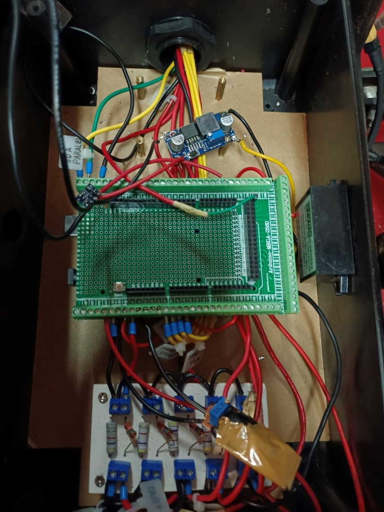
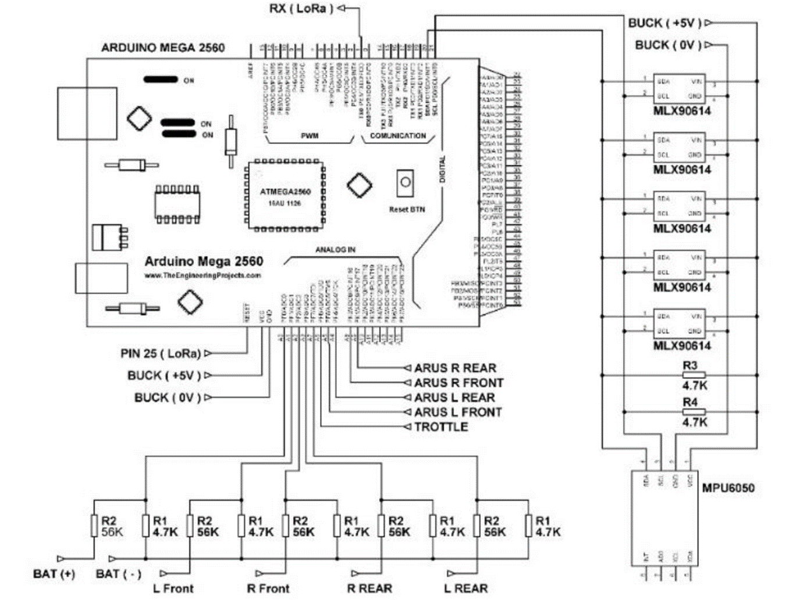
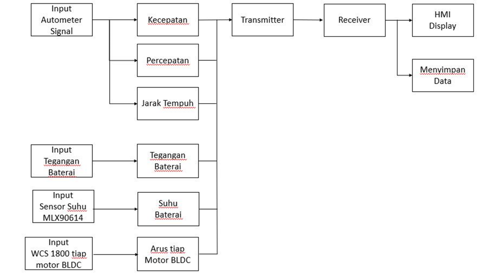
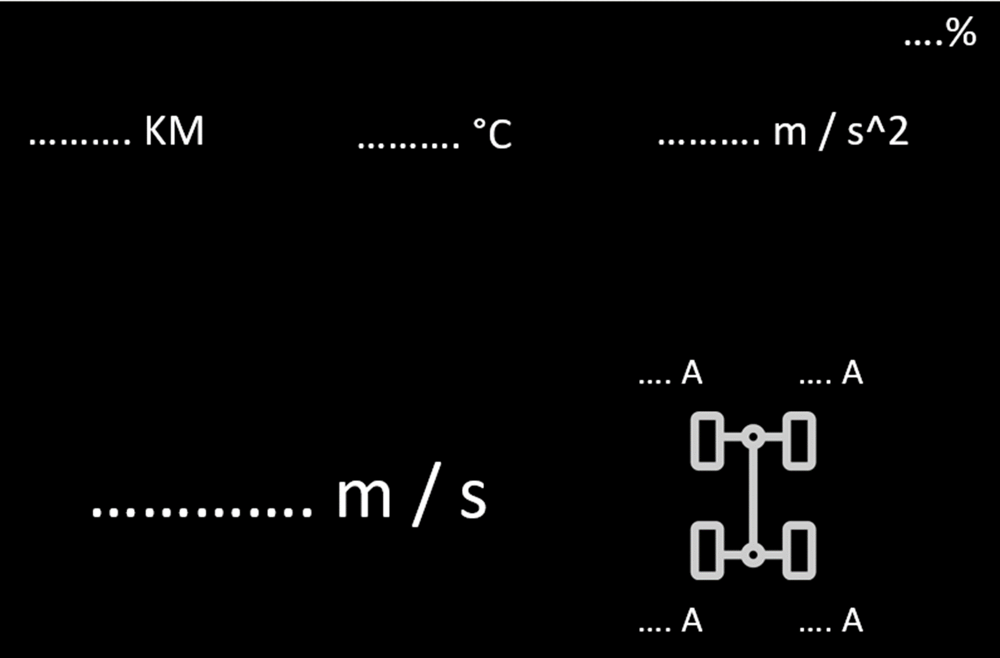
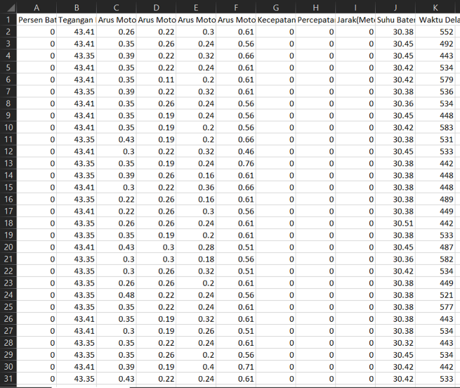
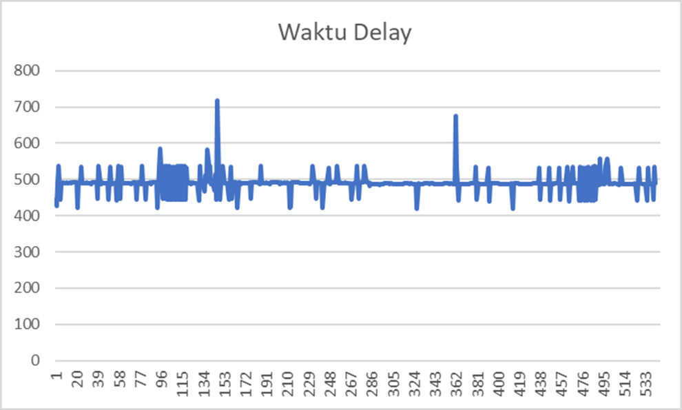

# Electric car telemetry: project documentation

[Back to the README](../README.md)

Supporting project evidence for this snapshot. **Source:** Annexes, section F "Electric Car Project" (PDF pages 11-13).

## What the evidence shows

The telemetry electronics, wiring and data flow from the original electric-car project, alongside a dashboard layout and historical data excerpts. This annex section does not contain a vehicle/chassis overview or a CAD-model image.

*Historical telemetry electronics prototype, showing controller hardware and wiring.*

*Historical telemetry wiring illustration; not a verified build schematic for every sketch variant.*

*Historical telemetry data-flow illustration showing sensing, transmission, reception, display and data storage.*

*Historical dashboard layout with placeholder values and telemetry units; not a live measurement screenshot.*

*Cropped historical telemetry spreadsheet showing recorded columns and sample rows; not a bundled raw dataset.*

*Historical telemetry analysis chart; not a new benchmark or validation result.*

## How it relates to this repository

These images provide historical context for the Arduino sketches and their several variants. They do not add editable design files, a raw telemetry dataset or analysis code. The dashboard image uses placeholders. Sample values in the spreadsheet and chart are not measured performance of the prepared code, and the wiring illustration is not verified for every sketch. Sketch pairing and the `receive2` caveat are in the README.

## Demo videos

- [Electric car demonstration](https://drive.google.com/file/d/1mFx9baTNFYu4Ka3BMOYRg58k4mlYzJqp/view?usp=sharing) (Google Drive). Anonymous viewer opened on 22 October 2026 (HTTP 200, titled `Electric Car.mp4`). Playback was not tested.

### Original video links (currently unavailable)

- [Second electric car video from the annexes](https://drive.google.com/file/d/1mLZITSttiAU0YqmRvQ8sthG_ib7kBGF/view?usp=sharing). The anonymous request returned HTTP 404 on 22 October 2026; the cause was not established.

## Evidence and rights note

This is supplied portfolio material, not an independent validation. The README's cautions on collaboration, third-party examples and publication rights still apply. No licence or additional permission is implied.
